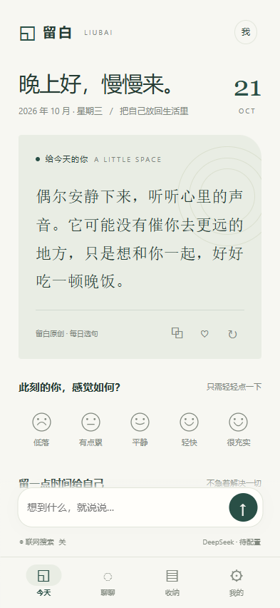
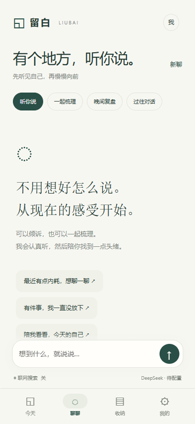
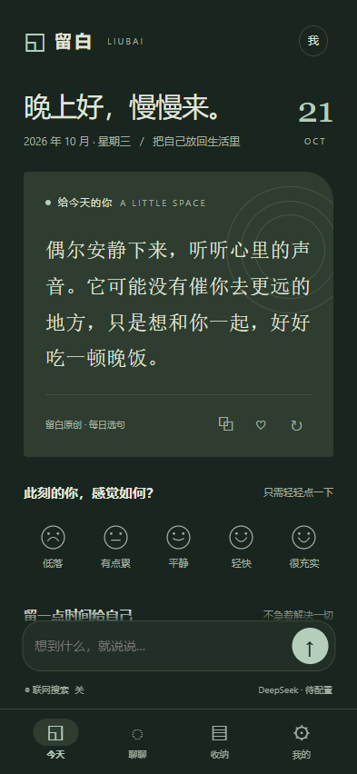

# 留白 Liubai

面向个人的免登录安卓生活助手，以情绪陪伴与自我整理为重心。暖白墨绿、安静克制；日常从一句话开始。

**[下载安卓 APK](https://github.com/taonian1989-hub/liubai-android/releases/tag/v0.1.0-preview.1)** · **[使用说明](docs/使用说明_v1.md)** · **[验收记录](docs/验收记录_v1.md)**

当前版本 **0.1.0 个人预览版**。支持 **Android 8.0 / API 26 及以上**，建议使用近期 Android System WebView。

  

截图为 APK 同一套界面资源的浏览器移动预览，不是真机截图。

## 使用

1. 从 [Releases](https://github.com/taonian1989-hub/liubai-android/releases/tag/v0.1.0-preview.1) 下载 `Liubai_0.1.0_preview.apk`，传到安卓手机安装。按系统提示允许所选文件来源安装应用。
2. 打开即用。每日选句、记录心情、随手记和小行动无需密钥、无需网络。
3. 在“我的 → 模型连接”配置 DeepSeek、Kimi 或 GLM 的开放平台 API Key。保存后不会回显，保存状态不代表已验证线上连接。
4. 回到“聊聊”，自然描述感受或困扰。可以选择“听你说”“一起梳理”“晚间复盘”；随时停止生成，失败后手动重试。
5. 需要公开信息时，主动打开输入框下的“联网搜索”。可在“我的”单独指定搜索服务商。点击来源卡片在系统浏览器核查。

应用不提供模型或搜索额度，所选服务商按自身规则计费。配置保存在本机，模型请求由手机直接发送，没有中转服务器。不要把密钥发到聊天里。

## 已实现

- **每日一句**：31段原创选句，按手机本地日期每日轮换，同一天稳定。可复制、收藏；可手动要求 AI 写一句。启用“每天打开时，AI 写一句给我”后，每日本机首次可用时自动请求一次；失败不会自动重试，仍保留离线句子。AI 生成明确标记。
- **心情足迹**：五种状态，首页一键记录、同日可修改、七天回看、删除和补写感受。
- **对话陪伴**：流式回应、连续追问、独立会话与历史、停止、重试、截断与错误状态、可选展示思考过程。
- **AI建议卡片**：模型可建议随手记或小行动，点击“确认收下”才会保存在本机。也可把整段回应收为可编辑笔记。
- **收纳**：随手记、小行动、收藏句子与心情，支持编辑、完成、搜索、删除确认。
- **三家模型**：DeepSeek、Kimi、GLM 的接口地址、模型ID、密钥、输出上限均可配置。切换模型会开启独立上下文，避免混用推理过程。
- **独立联网**：搜索与生成解耦，可组合 GLM 搜索和 Kimi 对话等。失败、零结果不会悄悄变成“已联网”回应。结果使用摘要，不自动读取全文。
- **个人偏好**：可编辑相处语气；暖白墨绿、夜间暖灰和跟随系统；Markdown 导出。

用户自述的 INFJ、处女座、B型血仅作为自我认同与文案偏好的线索，不用于推断性格、命运或心理诊断。

## 数据与边界

API Key 经 Android Keystore / AES-GCM 加密存储，原生读取接口仅返回是否保存，不回传密钥。修改接口地址后需重新填Key，避免误用凭证；携带密钥的请求不跟随重定向。浏览器预览禁收密钥。

生活记录、偏好和对话使用本机 WebView 存储，未额外加密，不自动云同步，应用已关闭系统自动备份。卸载、清除应用数据或设备故障会丢失记录，请先导出。导出为 Markdown，用于阅读归档，不提供一键导回；不包含密钥或内部思考文本。使用“清除本机生活记录”会保留偏好与密钥，密钥需在各服务商配置中单独移除。

调用模型时发送当前会话、相处偏好、设备日期和今日心情，不自动发送收纳库或其他会话。搜索开启时，当前问题开头最多120个Unicode字符作为搜索词发给搜索服务商；搜索摘要再提供给对话模型。应用只申请网络权限。

首页每天更新属于应用内推荐，**本版没有系统通知、后台推送、语音识别、定位、日历接入或闹钟提醒**。小行动是一份本机清单。应用只处理文字，不上传附件或图片。没有安装用户设备、没有接入真实API Key，不宣称已完成真机或实网验收。

保存上限为随手记/收藏合计200条、小行动200条、会话30段，每段12轮；生活存储约600万UTF-16单元上限，设备配额可能更低。达到容量时提示整理，不自动删除个人资料。AI每日句子缓存保留90天，心情按日期保存。

## 构建与验证

Java Android 宿主 + 随 APK 打包的 HTML/CSS/JS，无运行期第三方包或线上托管网页。仅允许本机打包资源使用原生桥，其他网页交给系统浏览器。

```powershell
pwsh -File scripts/provision_android.ps1
pwsh -File scripts/build_apk.ps1
```

已有工具链可用 `-ToolRoot`，其中包括 `jdk/<JDK目录>`、`platform/android-35`、`build-tools/android-15`。也可在Android Studio打开项目，使用JDK17、SDK35、AGP8.9.2、Gradle8.11.1；源码包不含Gradle wrapper。

预览APK使用本机 `work/signing/personal-preview.keystore` 签名；源码包不含私钥。同签名升级才能保留应用数据，请保管该文件。其他机器构建会生成自己的预览签名。

本地协议测试（JVM专用org.json 20240303测试依赖，不打入APK）：

```powershell
pwsh -File scripts/test_protocol.ps1 -ToolRoot work/toolchain -JsonJar work/test_dependencies/json.jar
```

本机网页预览：`node scripts/serve_preview.cjs`。浏览器预览不接收密钥，AI功能需安卓安装版。

界面测试以 Playwright CLI `run-code --filename tests/ui_smoke.js` 和 `tests/daily_edges.js` 运行，预览服务需在127.0.0.1:8798提供app/src/main/assets。界面模拟桥仅存在于tests，不打入APK。

## 目录与交付

```text
app/src/main/java/   原生宿主、加密、模型与搜索
app/src/main/assets/ 离线界面及原创每日句子
app/src/main/res/    图标及主题
scripts/            官方工具链下载、构建、协议检查
tests/              本地协议与浏览器模拟检查
docs/               设计、使用、验收及接口依据
outputs/            APK、源码压缩包、说明与校验文件
work/               本机签名、工具链及构建中间文件，不交付
```

验收标准为可编译签名APK、无登录门槛的完整本地记录流程、三家模型与搜索协议检查、移动界面流程及异常反馈。详见 `docs/验收记录_v1.md`。截图是相同资源的浏览器移动预览，不是真机截图；聊天测试截图会明确标记模拟内容。

本机项目位置及聊天展示副本的目录例外记录在本地 `README.local.md`，该文件不随公开源码发布。

基础模型客户端、加密存储、受限WebView宿主和构建工具复用了用户已有研脉/智讯项目的MIT代码；生活助手交互、界面、文案与LifePrompt为本项目新增。许可见LICENSE和THIRD_PARTY_NOTICES.md。
